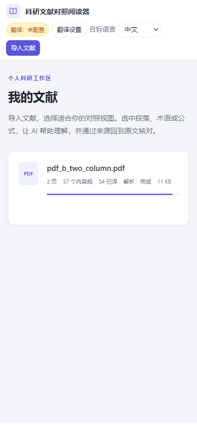
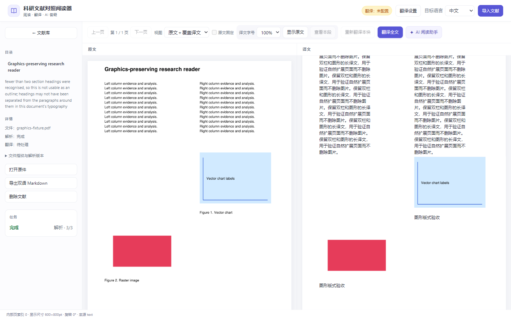
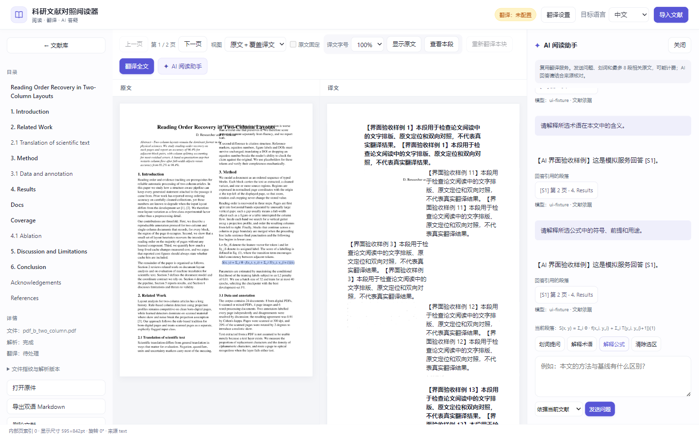
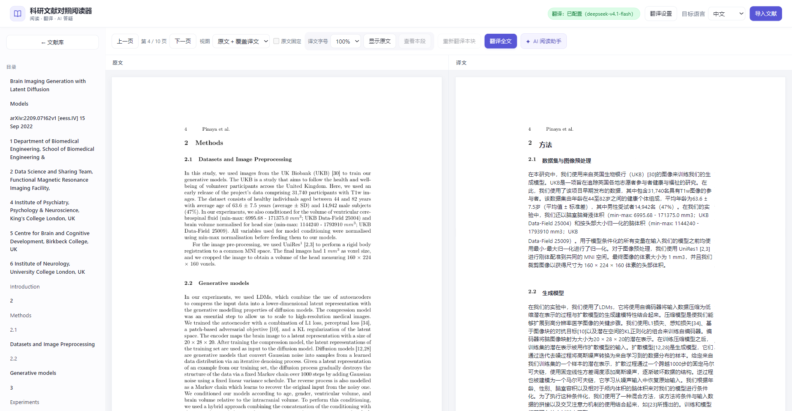
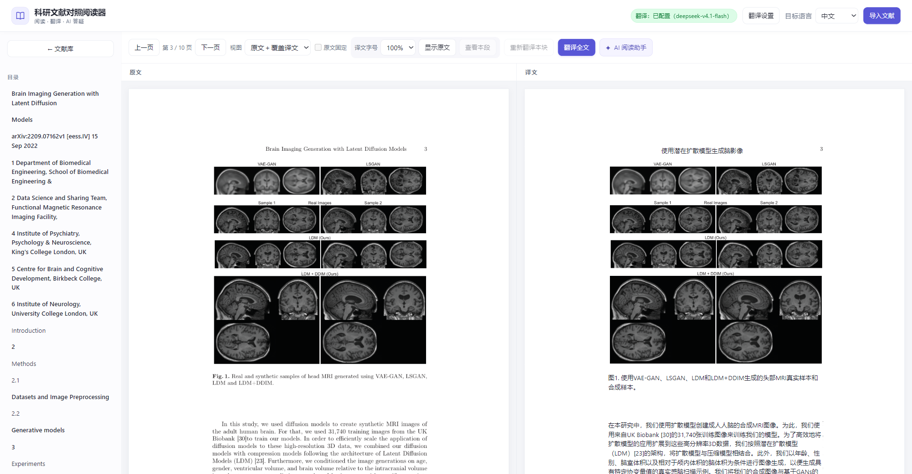
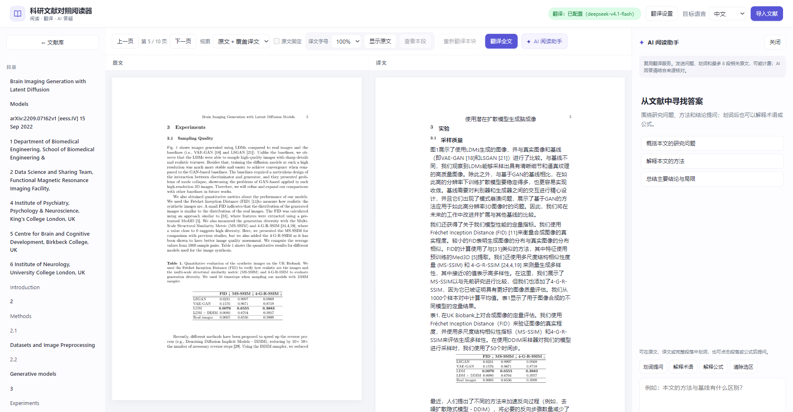

# 全量验收与阅读界面优化

日期：2026-10-11。

## 验收结论

本轮完整执行原有 28 个验收入口，均退出成功；增加前端运行测试和真实浏览器入口后，覆盖 30 个入口。
UI 与图形版式调整后，重新执行受影响的 6 个产品／前端入口，并重跑完整后端测试。
未改动的 OCR 引擎与性能测量沿用本轮基线，没有把两轮执行写成同一时刻的全跑。

| 项目 | 本轮结果 | 证据与边界 |
| --- | --- | --- |
| 完整后端测试 | 678 项通过，3 条既有警告 | 包含图形坐标、API、存量修复、AI、任务和存储 |
| 前端运行测试 | 17 项通过 | 使用真实前端函数和可控 DOM/API 边界 |
| 浏览器交互 | 78 项通过，无脚本错误 | 本机 Edge；1440、1024、768、390px 窗口；AI 界面回答明确标记为模拟 |
| 源码变异验证 | 7 项均能检测重新引入的缺陷 | 结束后确认源码恢复；没有与 UI 写入并行执行 |
| 坐标与阅读顺序 | 旋转角标、行序、字序检查通过 | 行序 928 条匹配行无逆序；版面为自编测试语料 |
| 块分类 | 235/235 个可评估样例正确 | 排除 132 个结构块、10 个合并匹配、1 个无关匹配，不能宣称所有图表提取成功 |
| 段落独立可寻址 | 235/246，95.53% | 合成语料，仍有边界，不等于真实论文全量正确 |
| OCR 与 DOCX 引擎 | 测量与异常处理执行成功 | 引擎存在，不等于它们已接入实际导入解析流程 |
| 实际运行服务 | API、worker 已更新；新 AI 路由、阅读模式和图形区域协议可用 | 保留当前数据目录及数据库配置 |
| 实际服务联调 | 自编文献导入→真实 worker 解析→新模式保存→真实 AI→样例清理通过 | `deepseek-v4.1-flash` 正确回答 `S=3`，附实际来源；未发送用户文献做测试 |

完整机器记录：[combined-report.json](acceptance/2026-10-11/full/combined-report.json)。
基线、最终后端、最终产品日志和指标保存在同目录，真实运行联调记录见 [live-stack.json](acceptance/2026-10-11/live-stack.json)。

## 性能与测量边界

本轮引擎／预览阶段 P95：文本提取 5.2ms、首次预览 235.8ms、翻页预览 237.2ms、OCR 识别 11813.4ms。
性能进程峰值工作集 1741.6MiB。它包含整套语料与 OCR 引擎测量，不是浏览器或常驻 API 的内存值。
这些阶段时间也不等同于用户从点击到完成绘制的完整首屏耗时。
OCR 置信度与 DPI 复现脚本是测量结果，不能因退出码为 0 就认定置信度足以代表识别质量。

## UI 设计依据与改动

参考 [Linear 的工作区与 Agent 状态呈现](https://linear.app/ai)，以及
[Perplexity 的回答来源展示](https://www.perplexity.ai/en-GB/hub/products/search)。
本项目据此采用清晰的工作区层级和来源入口；浅色、间距、配色与图标是针对长时间论文阅读的设计判断，没有复制其功能或声称完全复刻视觉。

- 浅色背景、白色阅读页、较弱分隔线与紫色操作强调，统一按钮、圆角、焦点样式和留白。
- 顶栏以文献导入和服务状态为主；阅读区集中导航、视图、译文控制与 AI 入口。
- 文献库用文件类型标识、中文处理状态和卡片层级；原来的实现说明改为阅读操作引导。
- 文件指纹和解析版本收进可展开区域；没有删除核对信息。
- AI 空状态增加快捷问题，只填入问题、不自动发送；回答、问题、来源与所选上下文形成不同层级。
- 修复隐藏按钮被样式显示的问题，补齐键盘导入；长模型名称不会撑破窄屏布局。
- 不加载外部字体，不增加前端框架，仍无构建步骤。

## 保留原格式的对照阅读

“原文＋覆盖译文”右侧使用完整原页画面分带组合，而非只显示提取出的文字。
保留图片、矢量图、公式、背景、未翻译内容和原来的栏位；译文在原栏位内自然展开，不使用段落内滚动条。
新增高度会将后续原页画面整体下移，图片按原比例呈现；图形区域不会被分带切开。
短标题可使用所在栏的可用宽度，避免中文标题被挤成竖排。

图形验收使用自编双栏 PDF，同时含栅格图片和矢量图。右侧实际截图检测到 27656 个蓝色图形像素及 14181 个红色图片像素，且两类区域均不被分带切开。
另外，图形区域坐标通过实际渲染像素验证四种旋转及裁剪页面，没有仅比较相同变换公式。

该方式仍依赖文本区域与图形区域识别；复杂嵌套图、整页栅格底图、误合并文字等真实版面尚需扩充语料。
图内文字保留原样，不宣称图内翻译或矢量可编辑输出；目前只是阅读视图，不生成同版式 PDF 文件。







## 仍未完成

OCR 和 DOCX 接入产品解析流程、识别文字人工修正、文献搜索、累计费用统计仍有缺口。
真实手机触控、其他浏览器、真实论文规模语料和复杂 AI 推导质量没有因本轮测试通过而自动完成验收。
详见 [限制说明](limitations.md) 与 [AI 阅读说明](ai-reading.md)。

## 复验

```powershell
python scripts/verify_all.py --output var/full-acceptance/run
python scripts/verify_all.py --group product --group frontend --output var/full-acceptance/product
```

全量入口需要原有 OCR／开发依赖、Node.js、本机 Edge 和 Playwright。依赖安装见 README。
实际已运行服务的自编样例测试可用 `python scripts/verify_active_stack.py`；
增加 `--ask-ai` 才发送一次真实 AI 请求，可能计费。脚本只清理本次创建的文献，不删除既有记录。


## 真实截图问题补验（2026-10-11）

用户截图暴露了原合成样例未覆盖的情况：章节编号被拆成独立标题并获得错误提示语译文；
原位标题继承流式卡片上边距，压住后续内容；复合插图的小图片间标签未被纳入保护范围。
之前的 78 项通过不代表这些真实版面已经验收通过。

本次修正：
- 独立数字及章节编号保留原样，不进入翻译计划；旧错误缓存不再覆盖原页。
- 原位布局取消标题卡片上边距；与原文完全相同的译文直接保留原画面。
- 相邻栅格图片按距离合并为复合插图保护区，保留内部模型名、样本标签和图片。
- 后端翻译计划与页面接口同时排除图内文字，图外正文和图注仍可翻译。
- 图形读取失败时终止翻译计划，避免未确认保护范围就发送图内文字。

实际运行服务已更新。只读检查截图对应文献第 4 页及图形最多的第 3 页，
使用本机 Edge 和 CSS 110% 放大模拟截图的显示条件；没有操作用户的 Chrome 标签，
也没有发送模型请求。浏览器中的写请求被验收脚本拦截，没有改变原文、译文或阅读位置。
真实页面补验 10 项通过：编号过滤、旧缓存不覆盖、竖排消失、无过窄译文区域／内部滚动、
标题原位、原画面连续、插图不切开、图内文字不覆盖、图外图注可翻译、无浏览器异常。

最终版本完整后端测试 681 项通过（3 条既有警告），前端运行测试 18 项通过，浏览器回归 78 项通过。
本小节及 [补验数据](acceptance/2026-10-11/screenshot-fix/report.json) 是最新版本的证据；
上方 30 入口合并报告保留为前一版全量检查记录，本轮没有重新运行未受影响的 OCR 基准。

图形保护依赖 PDF 的图像／绘图位置，复合图片采用相邻距离启发式，
复杂图形与混合正文／图内文字块仍需更多真实语料；不能据此宣称所有 PDF 均可精确识别。






## 表格与 AI 空回答补修（2026-10-11）

第 5 页截图中三线表被拆成多条细线，单元格 Real images 仍进入译文覆盖。
本次结合对齐横线、重复数值行列识别完整表格保护区，表格原样保留，表外图注继续翻译；
仅有多条横线的普通正文不会被整片保护。规则有距离和尺寸边界，尚不覆盖全部无框表格。

AI 空回答原因尚需真实服务响应确认；本次增加单次输出预算与 Ollama 思考强度控制，
支持正式文本分段，并区分输出耗尽、无正式回答和回答截断。不将思考文本冒充回答，
不自动重试。完整后端 686 项通过（3 条既有警告），浏览器回归 78 项通过。
真实 AI 诊断被自动审批拒绝，因为会发送具体文献段落到已配置的外部服务且可能计费；
已请求用户明确授权，在收到授权前不发送。此状态不应记为真实 AI 通过。


翻译任务结束后已更新当前 API 与 worker。实际第 5 页补验 6 项通过：整表识别、
11 个表内块不可翻译、表外说明可翻译、旧缓存不覆盖表格、表格画面不被分带切开、
无浏览器异常。真实页面验收不调用外部模型、不修改用户原文／译文／阅读位置。
[补验记录](acceptance/2026-10-11/ai-table-fix/report.json) 与截图：




## AI 恢复与 GROBID 辅助接入（2026-10-11）

本次继续后恢复了本地执行通道，并恢复 API 与 worker。真实服务验证全部使用自编样例，
没有向外部 AI 发送用户文献：直接服务返回 HTTP 200、finish_reason=stop，
正式回答 86 字符、思考 233 字符、总 token 450，来源验证通过。
当前实际运行 API 又完成自编 PDF 导入、真实 worker 解析、对照状态保存、真实 AI 回答与引用、
样例清理 6 项检查。没有删除用户文献或重解析其已缓存译文。
这验证了当前答疑链路，不能替代复杂论文问题和所有模型的质量验收。
[真实 API 检查](acceptance/2026-10-11/grobid-recovery/ai-recovery-api-final.json)。

第一次 API 自编样例因用户翻译任务占用独立 worker 而等待超时；样例已清理。
该失败不能当作 AI 模型错误，后续等待真实用户任务完成后复验通过。
同时修正了验收脚本在服务不可用时访问缺失 model 字段的错误，现在保留原失败原因。

GROBID 已作为默认关闭的本地结构辅助接入新文献解析路径。可信文本匹配、页码约束、
歧义回退、显式参考文献边界、原页／坐标保持与故障回退均纳入测试。
等待辅助服务时不持有 SQLite 写锁，已用独立数据库连接验证可写入。
[工程选择、配置和边界](grobid-assist.md)。

Docker 引擎已启动，Compose 配置检查通过；两次官方 GROBID 镜像拉取都遇到
registry-1.docker.io 网络 EOF，因此 GROBID 容器未启动、真实模型解析未验收。
当前用户服务保持辅助关闭，基础解析、阅读、翻译和 AI 不依赖它。
[真实 GROBID 验证失败记录](acceptance/2026-10-11/grobid-recovery/grobid-live.json)。

回归：完整后端 702 项、浏览器交互 78 项通过；后端仍有 3 条既有警告。
本次未重跑未受影响的 OCR 性能基准。较早全量报告和模拟回答不作为此次真实 AI 的替代证据。


## 2026-10-12 运行恢复

本次继续时 API／worker 均没有运行，Docker Desktop 界面存在但 Linux 引擎不可连接。
已恢复阅读器与 worker，现有 6 份文献和已保存翻译配置可读取。Docker 正常重启超时后，
关闭已确认卡住的界面并重启，Linux 引擎恢复到 29.8.1。

新增 Windows 启动脚本 `scripts/start_reader.ps1`，同时启动两项进程、等待 API 就绪、
记录后台进程的创建时间并保存日志。连续执行两次，复用当前 API 和同一个 worker，未新增后台进程。
启动流程修改已实际验证；没有把较早的 702 项后端／78 项浏览器检查当成本次重新执行的结果。

实际运行服务的自编样例重新通过 6 项联调，包括真实 worker 解析、对照状态、真实 AI 回答与引用、
本次样例清理。未向外部 AI 发送用户文献，也未删除已有记录。
证据见 [运行恢复报告](acceptance/2026-10-12/recovery.json)。

Docker 引擎恢复后再次拉取官方 GROBID 镜像，仍返回 Docker Hub 网络 EOF。
本机系统代理端口可连接，但直接及通过该代理的 Docker Hub TLS 连接都未在等待期限内完成。
GROBID 服务尚未启动，解析辅助继续保持关闭。


进一步排查：现有系统代理能够访问 GitHub（HTTP 200），访问 Docker Hub TLS 仍返回 EOF；
尝试 Google 官方公共镜像缓存也失败。未修改系统代理规则或 Docker 全局代理配置，
没有启动未经来源核对的第三方 GROBID 镜像。


## GROBID 已部署并启用（2026-10-12 最终状态）

此前镜像网络和权限阻塞已通过官方源码构建解决。服务与当前阅读器辅助调用均已通过真实验证。
源码提交与产物校验、构建路径、资源限制和复现说明见 [GROBID 部署说明](grobid-assist.md)。

真实服务自编样例通过；隔离流水线匹配 3 个块、原图和坐标保持；实际运行后台任务
确认辅助器状态 ok。实际论文在本机获得 20 个可对应的结构提示，原文和坐标保持一致，
既有活动修订、译文和标注未改写。所有测试样例清理完毕，现有文献仍为 6 份。

同时修复新版 PowerShell 自动转换 JSON 日期导致启动脚本进程身份误判的问题，改用 UTC 刻度比较。
重复启动已验证复用同一 worker。当前版本后端 702 项、浏览器 78 项通过；3 条警告仍为既有项。
[当前部署验收证据](acceptance/2026-10-12/grobid-enabled/report.json)。
较早的失败记录保留为排障历史，不代表当前状态。
