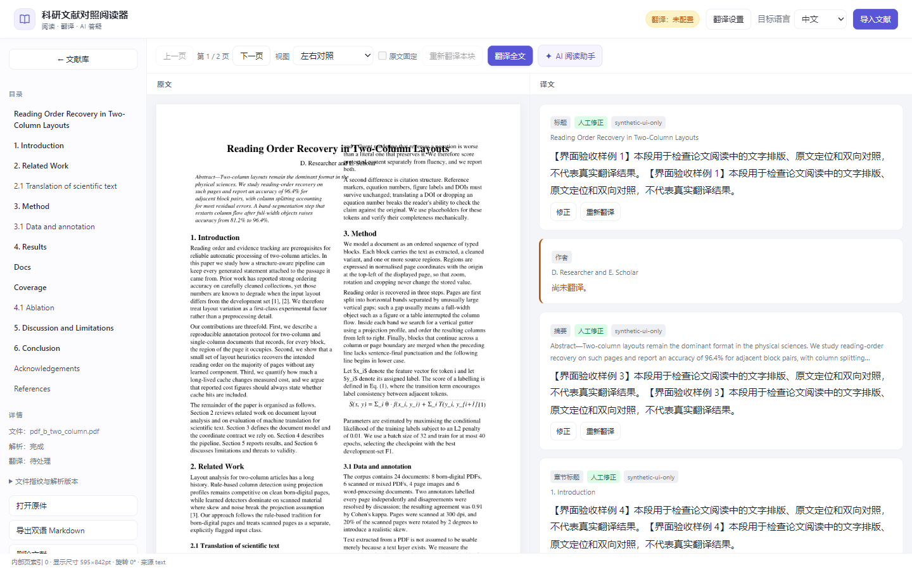
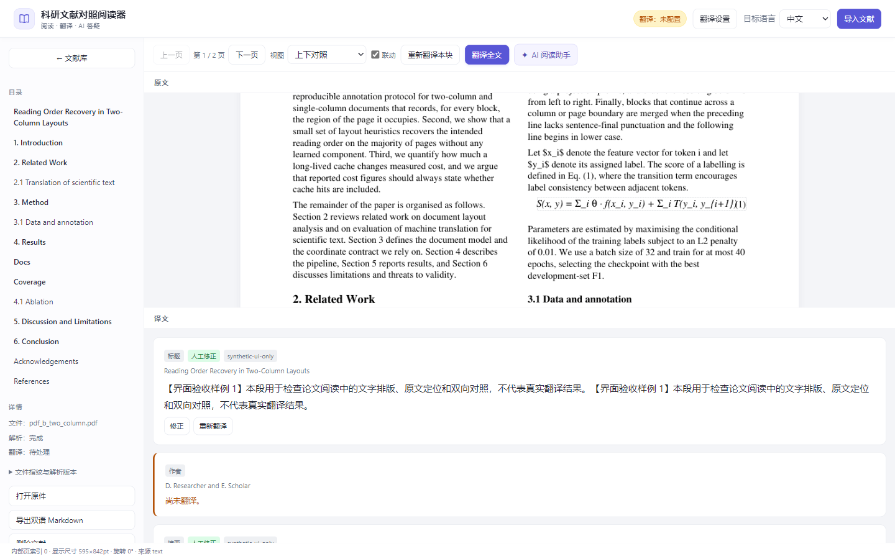
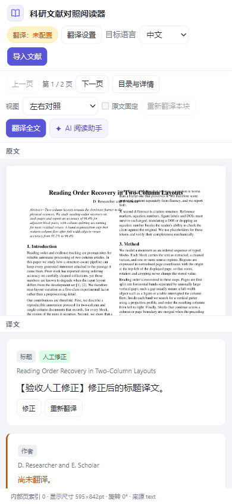
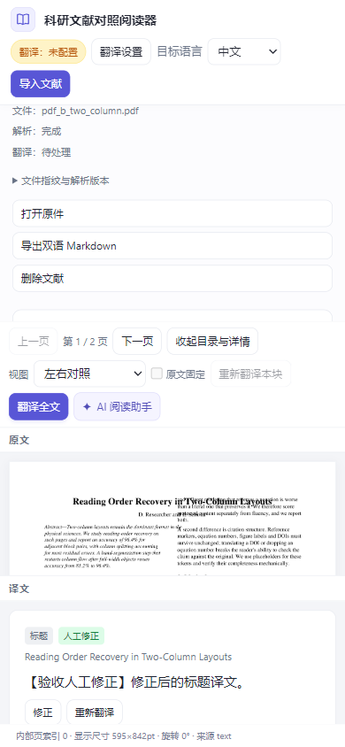
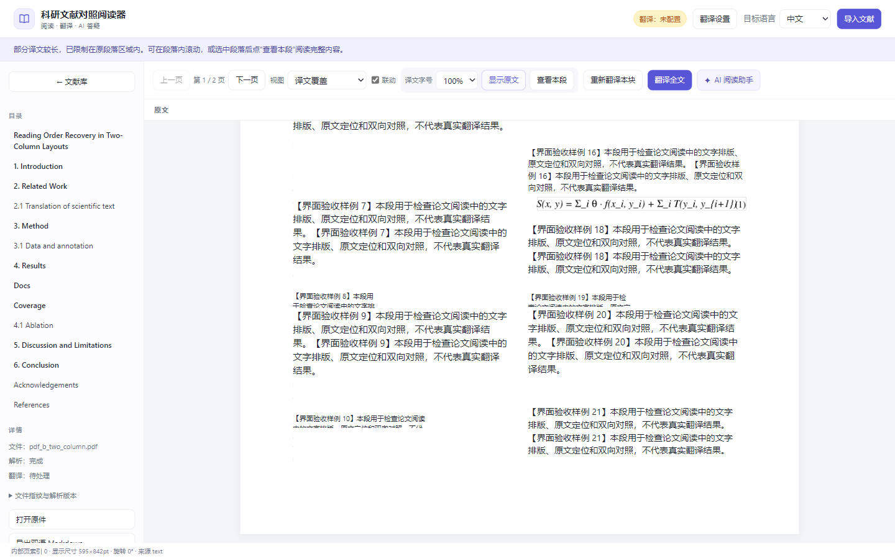
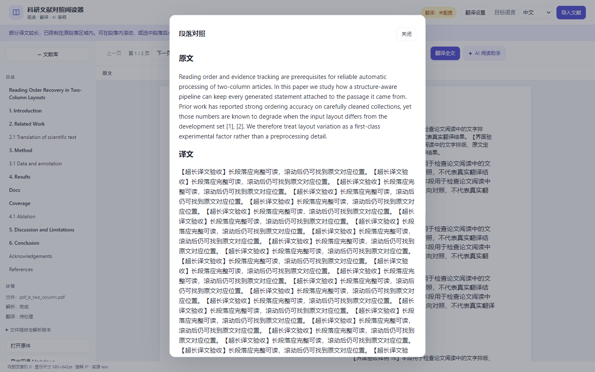

# 使用体验检查记录

2026-10-12 补充：真实论文暴露了竖排边注阻塞分栏、关键词串入摘要、分带扩展破坏页高对齐的问题。已改为固定页框、共享覆盖排版、实测字体适配和按修订修复存量数据，见 [排版规范](layout-alignment.md)。此前合成样例浏览器通过不能作为这类复杂 PDF 的排版验收。

日期：2026-10-11。

本次根据代码、接口实现和可执行验证检查阅读流程。修改包括阅读器前端、参考文献分类、存量修复，以及新阅读模式和 AI 问答接口。没有调整数据库结构或翻译提供商；OpenAPI 已同步生成。

## 已修复

| 使用场景 | 原有问题 | 修复结果 |
| --- | --- | --- |
| 导入新文献 | 请求未解析的页面，并且没有启动任务轮询 | 显示等待说明，自动跟踪解析，完成后刷新正文、目录和页数 |
| 重新打开文献 | 排队或运行中的任务不会继续更新 | 自动恢复任务轮询 |
| 后端响应较慢 | 定时器可能让多个轮询请求同时运行 | 等本次轮询完成后再安排下一次；离开文献后忽略旧响应 |
| 快速翻页、切换文献或语言 | 后返回的旧响应可能覆盖当前页面，甚至保存错误阅读位置 | 根据请求和导航版本仅应用有效响应；连续翻页按已经请求的页码前进 |
| 切换目标语言后导出 | 导出链接仍使用进入阅读器时的语言 | 导出链接随语言选择同步更新 |
| 查看标题译文 | 标题卡片提前返回，只显示原文 | 标题使用正常译文渲染流程，可查看译文和修正译文 |
| 重复导入文件 | 导入完成直接打开与地址变化事件重复打开同一文献 | 地址变化时仅交给导航事件处理；地址相同时刷新一次 |
| 文献超过 100 篇 | 前端忽略分页，较早导入的文献无法访问 | 增加“加载更多文献”，请求失败可原位重试 |
| 翻页或选择公式、图表 | 本块重译按钮可能保留上一页状态，或对不可翻译内容启用 | 翻页清除按钮状态，仅选择可翻译内容时启用 |
| 独立滚动与上下对照 | 页面仅设置最小高度，内容使整个页面长到 4369px，两个面板没有独立滚动范围 | 阅读区固定在视口内，各面板独立滚动；上下对照的两侧均可见 |
| 窄屏阅读 | 顶栏文字被挤成竖排，侧栏隐藏后丢失目录、任务和导出入口 | 顶栏正常换行，增加可展开的“目录与详情”入口 |
| 点击译文定位 | 只选中原文框，实际滚动的仍是译文侧 | 上下对照可滚动原文侧定位；左右对照按用户要求保持原文固定，仅高亮 |
| 左右对照阅读 | 右侧段落位置变化带动原文滚动，需要来回上下寻找 | 原文面板固定，右侧滚动或点击不改变原文位置；左侧仍可手动滚动 |
| 正文引用与参考文献 | 全文按条目格式猜测参考文献，正文引用被排除翻译 | 仅明确参考文献标题后归为参考文献；识别新章节后恢复正文分类 |
| 已导入文献的误判 | 新规则不能自动恢复数据库中旧标签 | 启动时修复活动修订中标题前的误判，保留锚点、译文和标注；实测当前用户数据修复 3 个块 |
| 覆盖阅读对照 | 单页覆盖不能同时看原文；等高行框迫使长译文内滚；单纯文字重排又丢失图形 | “原文＋覆盖译文”保留原页画面、图片、矢量图和栏位，段落展开时后续画面整体下移，两侧页长可不同 |
| AI 阅读支持 | 无文献答疑、划词提问和术语公式解释 | 新增 AI 阅读助手，复用翻译服务，发送有界相关上下文，来源可点击跳转 |
| 联动滚到页尾 | 原文滚动位置被浏览器限制后，触发反向滚动，译文从 3468.67px 回弹到 1970px | 按实际可用滚动范围记录目标，避免反向回弹 |
| 译文覆盖发生遮挡 | 长译文向下延伸，误合并块的巨大外框遮住其他段落；此前自动回退又使模式不可用 | 沿当前页连续文本区域定位，固定区域内滚，完整段落另可打开查看；保留覆盖模式 |

## 工程判断

保留原有无构建步骤的原生 JavaScript 前端。相比为每个入口单独补丁，统一导航版本、页面请求版本和任务轮询更能覆盖导入、重试、重新打开及快速操作的组合场景，且不需要增加框架依赖或改变存储模型。

## 验证证据

- `node --test tests/frontend/reader.test.cjs`：17 项通过。新增分带不切图和保留页面两端的断言；既有导航、轮询、语言导出和固定原文回归通过。
- `python scripts/verify_frontend_contract.py`：通过。使用独立临时数据库，导入样例 PDF 并运行真实 worker，检查接口字段、阅读状态、页面图片及前端资源。
- 完整后端测试最新为 678 项通过，3 条既有警告。覆盖图形区域的旋转和裁剪像素核对、存量修复及 AI 请求；真实 AI 小样例与模拟协议测试分别记录。
- 当前 78 项真实浏览器检查通过，无脚本错误。覆盖长译文自然展开、图片／矢量图像素保留、栏位、原文切换、AI 划词与来源跳转、窄屏、键盘导入和长模型名称。AI 界面回答为明确标记的模拟响应；自编样例另通过实际运行服务的真实 worker 和 AI 联调，并已清理。全量入口与 UI 设计见 [完整报告](full-acceptance.md)。
- 合成样例译文仅用于排版和操作验收，不用于证明机器翻译质量。窗口覆盖 1440×900、1024×768、768×1024、390×844；后两种是窗口尺寸模拟，未验证真实手机触控，也未验证 Firefox/Safari。
- 初始检查 25 项通过、6 项失败；补充联动检查后另发现页尾回弹。所有本次发现的问题均修复后复测。
- 最终完整结果：[report.json](acceptance/2026-10-11/report.json)。截图见下方；原始各轮记录保存在 `var/browser-acceptance/`。
- AI 真实服务小样例联调通过：复用 `deepseek-v4.1-flash`，正确回答算术平均数公式结果 `S=3` 并引用 `[S1]`，567 tokens；不发送用户文献。详见 [AI 阅读说明](ai-reading.md)。

## 实际截图与操作说明

桌面阅读区在视口内。左右对照时工具栏显示“原文固定”，右侧滚动或点击不会移动左侧；点击仍会高亮原文。上下对照的“联动”按段落对应滚动，到页尾不会反向回弹。

上下对照时两侧均可见，各自独立滚动。五种视图的控制都位于公共工具栏中。

窄屏可点击“目录与详情”展开侧栏，使用目录、任务和导出，再点击“收起目录与详情”恢复阅读空间。

覆盖模式现参考[沉浸式翻译普通 PDF 阅读](https://immersivetranslate.com/zh-Hans/docs/pdf-helper/)：
不透明白底、按段落定位、重叠限制、字号调整与原文切换。此前自由延伸和透明悬停的处理已替换，
“检测到重叠即自动回退”也已撤销，因为它会使用户选定的覆盖模式失效。

默认自适应字号最低 11px；手动选择 80%、120% 或 140% 时尊重用户字号选择，长译文在原段落内滚。
点击段落后按“查看本段”，或双击／键盘 Enter，可完整阅读原文和译文并修正译文；关闭入口固定在窗口顶部。
按“显示原文”可直接查看原页，再按“显示译文”恢复覆盖。

跨栏和远距离片段采用最大连续区域作为译文位置，其他原文片段只沿实际行框遮盖；这依赖现有解析质量，
不等同于 PDF Pro 的整页重排或 BabelDOC 同版式文件生成。没有移植插件的 OCR、翻译服务或文件导出引擎。

## 仍存在的缺口

1. OCR 引擎尚未接入实际解析任务，扫描件和图片仍无法完成文字解析与翻译。
2. DOCX 转换器尚未接入导入后的解析流程，实际产品仍拒绝该格式。
3. 缺少识别文字的人工修正接口（`BlockTextPatch`）。
4. 文献级 token 用量和费用归属仍未闭环。
5. 文献库目前没有关键词搜索和筛选；本次补齐分页入口，未新增检索接口。
6. 真实论文上的解析质量、翻译质量，其他浏览器及真实手机触控仍需独立验收。

这些缺口沿用原有能力边界，详见 `limitations.md`；没有将引擎存在、测试通过或接口成功等同于完整产品能力。
